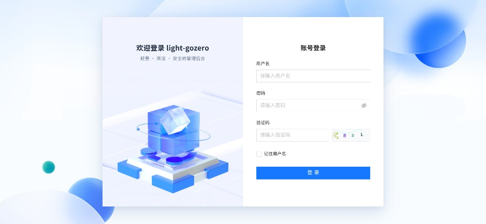
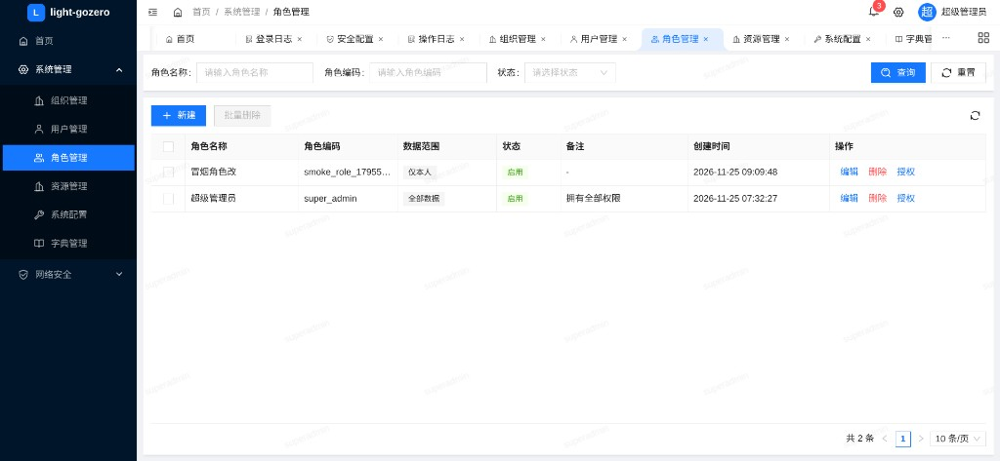
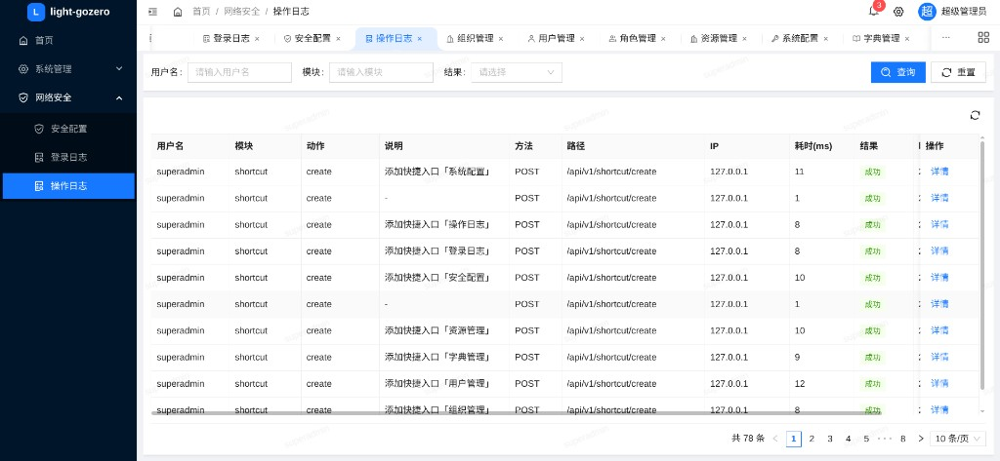

<div align="center">

# light-gozero

**基于 go-zero 的国密友好后台脚手架**

组织与权限 · 登录与审计 · 国密传输 · 可扩展业务服务

[](https://go.dev/)
[](https://go-zero.dev/)
[](https://gorm.io/)
[](https://redis.io/)
[](./LICENSE)

</div>

---

## 界面预览

<div align="center">

**登录页**



</div>

| 首页 | 用户管理 |
|:---:|:---:|
|  |  |

| 角色管理 | 操作日志 |
|:---:|:---:|
|  |  |

## 开箱能力

- 账号与登录：验证码、失败锁定、密码策略、会话踢出；传输国密密文，存储 bcrypt；Redis 不透明 Token
- 组织与权限：资源树（目录 / 菜单 / 按钮）、RBAC、数据范围
- 系统管理：组织、用户、角色、资源、字典、动态配置
- 审计：登录日志、操作日志、中文摘要、敏感字段脱敏
- 运行时防护：公开接口限流；请求体积 / 超时 / 熔断 / 卸载；批量上限
- 管理端：登录、工作台、个人中心；侧边 / 顶部布局；菜单与按钮权限跟资源树走
- 扩展：`system` 底座 + `demoservice` 示例；公共能力在 `common/`

## 安全与等保（应用侧）

- 身份鉴别：验证码、密码策略、失败锁定
- 访问控制：RBAC、数据范围
- 安全审计：登录日志、操作日志、敏感字段脱敏
- 通信保密：敏感字段国密密文传输
- 入侵防范：公开接口限流、请求与批量上限

应用侧基线，不构成测评结论。

## 技术选型

- 后端：Go 1.27 · [go-zero](https://github.com/zeromicro/go-zero) · GORM / MySQL · Redis · UUIDv7
- 管理端：Vue 3 · TypeScript · Vite · Pinia · [antdv-next](https://antdv-next.com/)
- 约定：[zeromicro/ai-context](https://github.com/zeromicro/ai-context)（`.api` → goctl → logic）

```text
.
├── common/              跨服务公共能力
├── deploy/sql/          初始化库表（含种子账号）
├── web/admin/           管理端
└── service/
    ├── system/          账号、权限、字典、配置、审计
    └── demoservice/     扩服务时的最小样例
```

## 本地体验

本机需要 Go、MySQL、Redis，以及 Node（管理端）。演示库名 `light_gozero`。

```bash
git clone git@github.com:jiangfolio/light-gozero.git
cd light-gozero
git submodule update --init --recursive

make init-sql          # 导入库表与种子数据（默认 docker 容器名 mysql）
make run-system        # 后端  :8888
make web-dev           # 管理端 :8081
```

http://127.0.0.1:8081 ，演示账号 `superadmin` / `Admin@123456`。仓库内密钥仅供本地演示。

更多命令见 `make help`。

新增接口：改 `.api` → goctl 生成 → 在 logic 写业务。约定见 [`.cursorrules`](.cursorrules/)。主配置：[`service/system/api/etc/system.yaml`](service/system/api/etc/system.yaml)。

## License

[Apache License 2.0](LICENSE) · 版权声明见 [NOTICE](NOTICE)

基于 [go-zero](https://github.com/zeromicro/go-zero) · 工程约定参考 [ai-context](https://github.com/zeromicro/ai-context)
